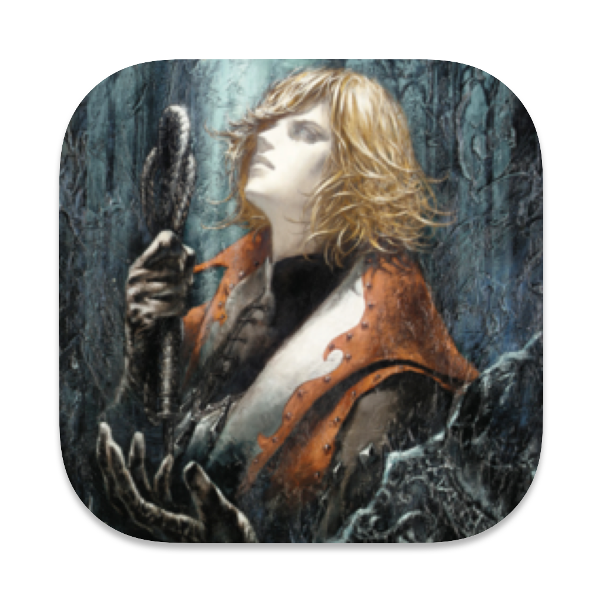

<p align="center">
  
</p>

# Eclipse Collection
A launcher designed to unify Castlevania RoB, SotN, CoD, LoI, and ReBirth into a single cross platform collection.

> [!WARNING]
> There was heavy usage of an LLM to make this. I do not have the time to write this all by hand, I wrote the framework or base of the code, then I gave it to my LLM to clean up and fix. I believe AI can be used as a tool, and if it's guided and managed correctly, that it can be incredibly efficient and helpful.  

## Games in the Collection
| Title | Original Platform | Release Year | Supported Regions | Container Runner |
| :--- | :--- | :---: | :---: | :--- |
| **Castlevania: Rondo of Blood** | PC Engine | 1993 | US / JP | RetroArch (`mednafen_pce_fast`) |
| **Castlevania: Symphony of the Night** | PlayStation | 1997 | US / JP / EU | RetroArch (`pcsx_rearmed` / `swanstation`) |
| **Castlevania: Lament of Innocence** | PlayStation 2 | 2003 | US / JP / EU | PCSX2 Portable Container |
| **Castlevania: Curse of Darkness** | PlayStation 2 | 2005 | US / JP / EU | PCSX2 Portable Container |
| **Castlevania: The Adventure ReBirth** | WiiWare | 2009 | US / JP / EU | Dolphin Portable Container |

## Quick Start (Sort of)
I have packages for Windows and macOS (13+) with plans for a Flatpak and appimage. 
Most of this is developed on my Mac on Golden Gate 27. That being said, PCSX2 has issues unless you set up Rosetta 2. (By default it uses the Metal build) 
I have tested it on Windows 11, 10, and 7, then also on macOS 11, 13, 14, 26, and 27. Big Sur took some tinkering, so don't expect it to instantly work on anything that is older than Sequoia.

When you first run the launcher it should create several folders: `cores` `emulators` `bios` `eclipse-app` `games`
Drop your games into the corresponding game folders in the ```games``` folder. For ```bios```, the files needed are the PC Engine bios (syscardX.pce), PS1 bios, and PS2 bios.  

To install the emulators, go to settings and select 'Containers & ROMs' then run 'Initialize/Download Containers'.

To run in dev mode, ```cd``` to the eclipse-app folder and run the run.sh script. 

## Build it from the source

#### Dependencies:
- **Go** `v1.22+`
- **Wails** `v2.x`
- **Xcode Command Line Tools** (only on macOS)
- **WebView2 Runtime** (only on Windows. Should be preinstalled.)

## Contributing
Contributions and requests are welcome

## License
Distribute under the MIT License. See ```License``` for more info.

## Legal Disclaimer
This project is an open source launcher/frontend interface. This does **Not** include ROMs, Disc Images, BIOS, or proprietary game assets. You must use your own legally obtained game backups to play.

Castlevania and all related titles and characters are trademarks of **Konami Digital Entertainment**. 

## Credit
The original creators:
* **Konami & M2** for the Castlevania games
* **Ayami Kojima** who did the amazing Castlevania artwork 
* **Michiru Yamane** who composed the original music scores for these games

The open-source community:
* **Wails v2** Majority of this is built using Wails
* **Libretro** for Retroarch and the libretro cores
* **PCSX2 Team** for PCSX2
* **Dolphin Emulator Project** for Dolphin

The Controller Icon pack:
* **Zacksly** for the Xbox Series Button Icons and Controls ([zacksly.itch.io](https://zacksly.itch.io), licensed under [CC BY 3.0](https://creativecommons.org/licenses/by/3.0/))
